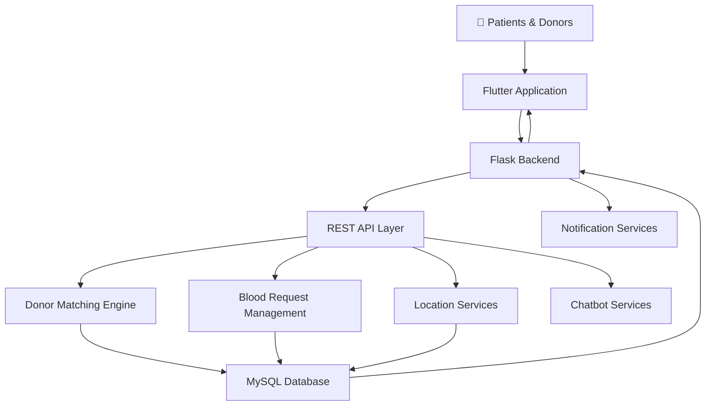
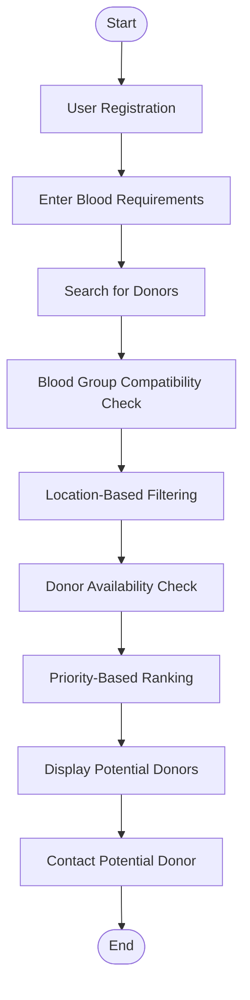

<div align="center">


# 🩸 AI-Powered Blood Availability System

### Connecting Blood Donors with Patients Through Intelligent Technology

<p>


</p>

<p>


</p>

<a href="https://github.com/Rafiqua-9Sultana/ai-powered-blood-availability-system">

</a>

</div>

---

## 🔴 01. Project Overview

**AI-Powered Blood Availability System (BloodBot)** is an intelligent healthcare platform designed to simplify blood donor discovery and improve access to blood availability information.

The system aims to connect patients with potential blood donors through intelligent matching, geographical location analysis, donor availability information, and priority-based searching.

By combining artificial intelligence, machine learning, database management, and location-based services, the platform aims to make the blood donation process more organized and accessible.

## 🎯 02. Problem Statement

Finding suitable blood donors during medical emergencies can be challenging due to:

- Delays in identifying compatible blood donors.
- Lack of centralized and updated donor information.
- Limited communication between patients and donors.
- Difficulty locating nearby available donors.
- Manual donor-search and prioritization processes.

**Our Approach:** Develop a centralized and intelligent platform that simplifies donor discovery and supports efficient blood request management.

## ✨ 03. Key Features

<table>
<tr>
<td width="50%" valign="top">

### 🩸 Intelligent Donor Matching
Identifies potential donors using blood group compatibility and relevant matching parameters.

### 📍 Location-Based Search
Helps discover potential donors based on geographical proximity.

### 👥 Donor Management
Maintains donor profiles and availability information.

### ⚡ Priority-Based Matching
Ranks potential donors according to relevant priority factors.

</td>
<td width="50%" valign="top">

### 🏥 Blood Availability
Supports blood availability and inventory information management.

### 🚨 Emergency Requests
Supports urgent blood request submission and management.

### 🔔 Notifications
Supports communication with potential donors through notification services.

### 🤖 Chatbot Assistance
Provides a conversational interface for blood availability and donation-related queries.

</td>
</tr>
</table>

## 🏗️ 04. System Architecture

The application follows a layered architecture consisting of three major components.

| Layer | Responsibility |
|---|---|
| Presentation Layer | Flutter interface, patient interaction, donor profiles and blood requests |
| Application Layer | Flask backend, donor matching, prioritization and API processing |
| Data Layer | MySQL database, donor records, blood requests and availability information |

### Architecture Diagram



## 🤖 05. Intelligent Blood Donor Matching Algorithm (IBDMA)

The system incorporates the concept of an **Intelligent Blood Donor Matching Algorithm (IBDMA)** to identify and prioritize potential donors.

The matching approach considers multiple parameters:

### Matching Parameters

| Parameter | Description |
|---|---|
| Blood Group Compatibility | Checks compatibility between donor and recipient blood groups. |
| Geographical Location | Considers the distance between the donor and patient. |
| Donor Availability | Evaluates the donor's current availability. |
| Request Urgency | Considers the priority of the blood request. |
| Donation History | Considers relevant previous donation information. |

### Weighted Priority Formula

```text
Priority Score =

(W1 × Compatibility Score) +
(W2 × Location Score) +
(W3 × Availability Score) +
(W4 × Urgency Score) +
(W5 × Donation History Score)
```

Where each weight represents the contribution of its corresponding parameter.

**Important:** Blood group compatibility and medical eligibility must be mandatory checks, not factors that can be overridden by a high priority score. Final donor suitability and crossmatching must be verified by qualified healthcare professionals.

## 🛠️ 06. Technology Stack

<table>
<tr>
<th>Category</th>
<th>Technologies</th>
</tr>
<tr>
<td><b>Programming Language</b></td>
<td>Python</td>
</tr>
<tr>
<td><b>Frontend</b></td>
<td>Flutter, Dart</td>
</tr>
<tr>
<td><b>Backend</b></td>
<td>Flask</td>
</tr>
<tr>
<td><b>Database</b></td>
<td>MySQL</td>
</tr>
<tr>
<td><b>Machine Learning</b></td>
<td>Scikit-learn</td>
</tr>
<tr>
<td><b>Maps & Location</b></td>
<td>Google Maps API, Geopy</td>
</tr>
<tr>
<td><b>Notifications</b></td>
<td>Firebase Cloud Messaging</td>
</tr>
<tr>
<td><b>Conversational Interface</b></td>
<td>Dialogflow</td>
</tr>
<tr>
<td><b>Development Environment</b></td>
<td>Visual Studio Code</td>
</tr>
<tr>
<td><b>Version Control</b></td>
<td>Git, GitHub</td>
</tr>
</table>

## 🔄 07. Application Workflow



## 💻 08. System Requirements

### Hardware Requirements

- Computer or laptop.
- Minimum 4 GB RAM.
- Minimum 256 GB storage.
- Internet connectivity.
- Android smartphone for mobile application access.

### Software Requirements

- Python 3.10 or later.
- Flutter SDK.
- Flask.
- MySQL Server.
- Scikit-learn.
- Google Maps API.
- Geopy.
- Visual Studio Code.
- Git.

## 🌍 09. Applications

- Emergency blood donor identification.
- Hospital and blood bank coordination.
- Blood donation organizations.
- Community-based donor networks.
- Medical emergency support systems.
- Blood availability information management.

## 📊 10. Advantages

| Advantage | Benefit |
|---|---|
| Reduced Manual Effort | Simplifies the donor-search process. |
| Intelligent Matching | Helps identify relevant potential donors. |
| Location-Based Discovery | Supports nearby donor identification. |
| Centralized Information | Organizes donor and request records. |
| Better Communication | Supports interaction between patients and donors. |
| Priority Management | Helps organize urgent blood requests. |

## ⚠️ 11. Limitations

- Requires accurate and regularly updated donor information.
- Depends on internet connectivity for online operations.
- Donor availability may change unexpectedly.
- Location accuracy depends on available location services.
- Blood compatibility requires professional verification.
- Matching effectiveness depends on the quality of available data.

## 🔮 12. Future Scope

- Advanced machine learning models for donor recommendations.
- Integration with hospital and blood bank management systems.
- Real-time blood stock availability.
- Improved emergency notification services.
- Multilingual chatbot support.
- Advanced analytics and reporting dashboard.
- Enhanced security and privacy mechanisms.
- Expansion to a larger network of hospitals and donors.

## 🤝 13. Contributions

Contributions, suggestions, and improvements are welcome!

1. Fork this repository.
2. Create a new branch.
3. Make your changes.
4. Commit your changes.
5. Submit a pull request.

## 📁 14. Project Information

| Detail | Description |
|---|---|
| Project Name | AI-Powered Blood Availability System |
| Product Identity | BloodBot |
| Domain | Artificial Intelligence & Healthcare |
| Frontend | Flutter |
| Backend | Python Flask |
| Database | MySQL |
| Matching Approach | Intelligent Blood Donor Matching Algorithm (IBDMA) |
| Repository | GitHub |

---

<div align="center">

## ❤️ Our Vision

### Making blood availability smarter, faster, and more accessible through technology.

**Every donor matters. Every second counts. Every life matters.**

<br/>

<a href="https://github.com/Rafiqua-9Sultana">

</a>

<a href="https://www.linkedin.com/in/rafiqua-sultana-a03270252">

</a>

<br/><br/>

⭐ **If you find this project interesting, consider giving it a star!**


</div>